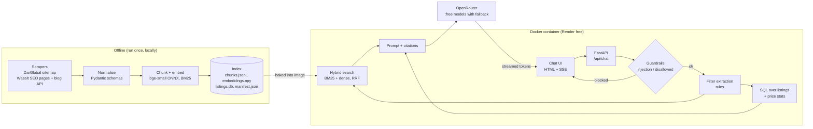

# DarGlobal & Wasalt Property Assistant

A RAG chatbot that answers questions about **DarGlobal** projects and **Wasalt** property listings,
built from publicly available data on [darglobal.co.uk](https://darglobal.co.uk) and [wasalt.sa](https://wasalt.sa).
It uses free models on OpenRouter, runs as a single Docker container, and is deployed on Render.

**Live demo:** `<RENDER_URL>`  ·  Built by Muhammad Qaim Ali for the Junior AI Engineer (Applied AI) assessment.

> The free Render instance sleeps after 15 minutes idle. If the first load takes ~1 minute, it is waking up.

## What it can do

- **Project Q&A** – "Which DarGlobal projects are in Oman?", "When will Tierra Viva be completed?",
  "Which projects are partnered with Trump?"
- **Listing search with real filters** – "3 bedroom apartments for sale in Riyadh under 1.2M",
  "cheapest villas for rent in Jeddah" → SQL over scraped Wasalt listings, shown as cards with links.
- **Market snapshots** – "average rent for villas in Jeddah" → median, range and price per sqm from the scraped sample.
- **Follow-ups** – "what about Dammam?" keeps the previous filters.
- **Citations** – every answer cites numbered sources, with links shown under the answer.

## Architecture



**Request flow:** a message is parsed for listing filters (purpose, type, city, district, bedrooms,
price range, sort) with deterministic rules. Then:
- If it is a listing question, SQLite returns matching listings plus price stats, relaxing filters step by step when nothing matches.
- In parallel, hybrid search (BM25 + dense vectors, merged with reciprocal rank fusion, with boosts for named projects) picks the top text chunks.
- Everything goes into **one** LLM call, which streams back to the browser.

### Design decisions

| Decision | Why |
|---|---|
| Scrape and index **offline**, ship a read-only index in the image | No scraping at request time, no database to host, reproducible snapshot, fast cold start |
| **One LLM call per turn**; filters extracted by rules | OpenRouter free models allow ~50 requests/day without credit, and their tool-calling is unreliable |
| Ordered **fallback list of `:free` models** (+ `openrouter/free`) | Free models get rate-limited or retired without notice; nothing paid is ever in the chain |
| **bge-small-en (quantised ONNX via fastembed)** + BM25, not PyTorch | Fits Render's 512 MB free instance; BM25 alone works if the model is unavailable |
| **SQL for listings**, vectors for prose | "Under 1.2M with 3 beds" is a filter, not a similarity search |
| Answer cache + per-IP rate limit | Protects the free-tier quota while reviewers test |
| Retrieval-only fallback reply | If every model is down, the user still gets the matching sources instead of an error |
| Guardrails (`app/guardrails.py`) block prompt-injection/jailbreak and clearly disallowed inputs before the LLM call | Defense-in-depth beyond the system prompt's own rules, and it never spends quota on a message that was never going to get a real answer |

## Data

| Source | What | How |
|---|---|---|
| DarGlobal | Project pages (location, brand partner, status, facts, amenities, FAQs), about/FAQ/why-invest pages, a sample of blog/insights/press | `sitemap.xml` → country category pages → project pages |
| Wasalt | Sale & rent listings across major Saudi cities; overview pages; blog posts; projects (best effort) | Server-rendered SEO listing pages (`/en/properties-for-sale-in-riyadh?page=N`), WordPress REST API for the blog |

Respectful scraping: robots.txt is honoured (Wasalt's `/search` is disallowed and never requested),
~1 request/second per host, on-disk caching so reruns don't refetch, and **no personal data** (agent names
and phone numbers are not stored). The snapshot date is shown in the UI and given to the model.

## Run it

### 1. Scrape and build the index (your machine)

```bash
python -m venv .venv && source .venv/bin/activate        # Windows: .venv\Scripts\activate
pip install -r requirements-ingest.txt
python -m ingest.scrape_darglobal                        # ~5 min
python -m ingest.scrape_wasalt --max-listings 1500       # ~15 min
python -m ingest.build_index                             # downloads the 70 MB embedding model once
pytest -q
```

If a site starts returning 403s, `pip install playwright && playwright install chromium`, then add `--browser`.

### 2. Run locally

```bash
export OPENROUTER_API_KEY=sk-or-v1-...                   # Windows: set OPENROUTER_API_KEY=...
uvicorn app.main:app --reload --port 8000
# or with Docker, capped like the free tier:
docker build -t darglobal-chatbot .
docker run --rm -p 8000:10000 -m 512m -e OPENROUTER_API_KEY=$OPENROUTER_API_KEY darglobal-chatbot
```

Open http://localhost:8000. Without an API key the app runs in retrieval-only mode.

### 3. Deploy (Render, free)

1. Push this repo to GitHub (including `data/index/`).
2. Render → **New → Blueprint** → select the repo (uses `render.yaml`), or **New → Web Service → Docker**.
3. Set `OPENROUTER_API_KEY` in the service's Environment tab.
4. Optional: an UptimeRobot / cron-job.org monitor hitting `/health` every 10 minutes keeps it awake.

### Evaluate

```bash
python scripts/eval.py --url http://localhost:8000      # 20 questions incl. out-of-scope, injection and guardrails
python scripts/list_free_models.py                      # current free models, to update OPENROUTER_MODELS
```

## Configuration

| Env var | Default | |
|---|---|---|
| `OPENROUTER_API_KEY` | – | required for LLM answers |
| `OPENROUTER_MODELS` | `google/gemma-4-31b-it:free,nvidia/nemotron-3-ultra-550b-a55b:free,openrouter/free` | tried in order |
| `EMBED_MODEL` | `BAAI/bge-small-en-v1.5` | used at index-build time; recorded in the manifest |
| `USE_DENSE` | `1` | `0` = BM25 only |
| `RATE_LIMIT_PER_MIN` | `12` | per IP |

## Project structure

```
ingest/   scrapers, HTML extraction, schemas, index builder   (offline)
app/      FastAPI app, filters, hybrid search, prompts, OpenRouter client, static UI
data/     raw/ scraped JSONL, index/ what the container serves
eval/     evaluation questions        scripts/  eval runner, free-model lister
tests/    parser tests on fixtures, mock OpenRouter server, sample-data generator
```

## Limitations and next steps

- Data is a dated snapshot; a scheduled GitHub Action could rescrape weekly and redeploy.
- Wasalt listings are a sample (~1.5k), not the full inventory; the bot says so when quoting market figures.
- DarGlobal rarely publishes prices, so the bot points to the sales team rather than guessing.
- Next: lead capture ("register interest") into a CRM, a cross-encoder reranker if memory allows,
  and LLM-as-judge evaluation on a larger question set.

*Not affiliated with DarGlobal or Wasalt. All content belongs to its respective owners.*
